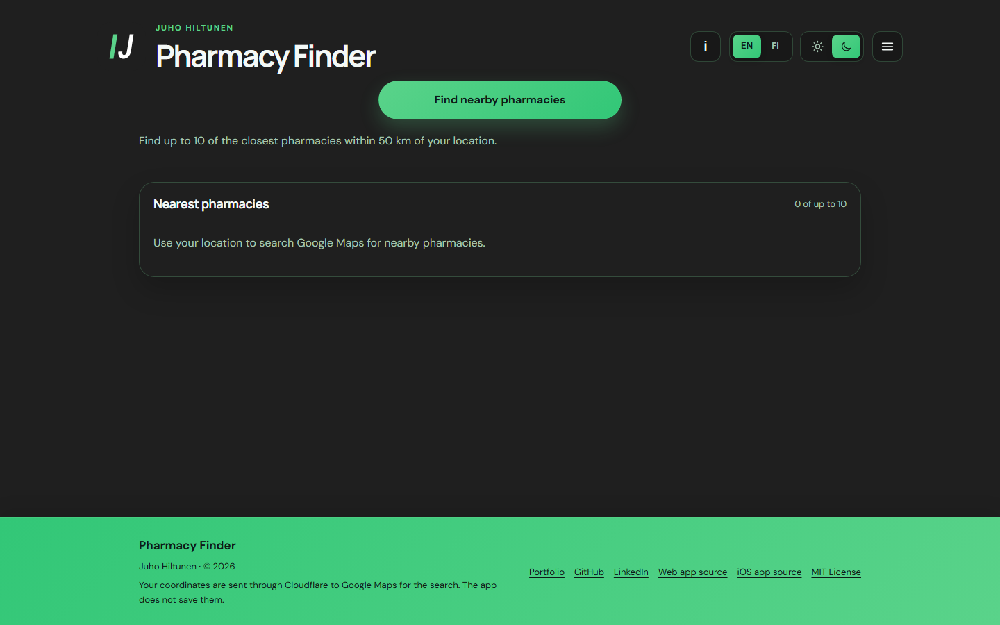
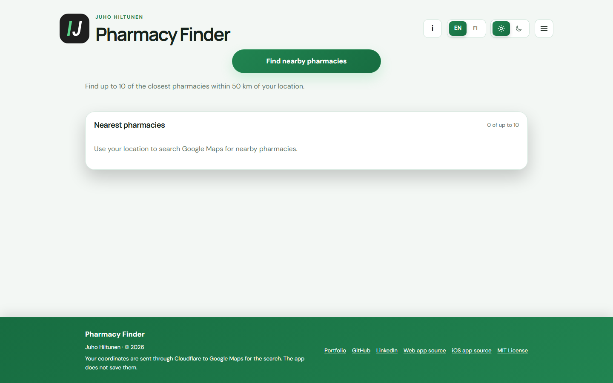

# Pharmacy Finder Web

React, TypeScript, and Vite web client for the Pharmacy Finder portfolio project.

[Open the live GitHub Pages demo](https://hiltunenjuho.github.io/nearest-pharmacy-web/).

## Screenshots

<p align="center">
  
  
</p>
<p align="center"><em>The current desktop interface, captured in both appearance modes.</em></p>

## Features

- Uses browser geolocation to search around the user's current position anywhere in the world
- Searches Google Places API (New) within a maximum 50 km radius and returns up to 10 nearby pharmacies, ranked by distance
- Displays pharmacy details and today's opening hours when Google Maps provides them
- Filters results to all pharmacies, those open now, or closed pharmacies ordered by next opening time (nearest first for ties)
- Shows an estimated countdown to closing or the next opening when Google Maps provides a timestamp
- Provides direct route planning and phone links when a number is available
- Includes an English/Finnish language toggle, initially using the browser's system language
- Includes an animated light/dark theme toggle, initially following the system preference
- Provides an information panel and an "Info for nerds" technical overview
- Includes a portfolio-style footer and a responsive layout
- The Worker validates coordinates and language, allows configured browser origins, and rate-limits searches to 8 requests per client IP per 60 seconds

## Code layout

- `src/App.tsx` contains the page state and interface.
- `src/lib/` contains location, API-client, and link helpers.
- `worker/` contains the Cloudflare API proxy and its tests.
- `src/styles.css` contains the responsive layout and theme tokens.

Google Maps Demo Key searches are available without a billing account, but the key has daily limits and is intended for prototypes and portfolio demos. Search availability is not guaranteed. Pharmacy details may be missing or out of date; confirm opening hours before travelling.

The browser sends the coordinates needed to perform a search to the Cloudflare Worker, which forwards them to Google Places. Neither app nor Worker stores coordinates or results. The Google Maps Demo Key must remain a Cloudflare Worker secret; never put it in frontend configuration or source control. The Worker endpoint is public, CORS is not authentication, and rate limiting is not a production security boundary.

## Local development

1. Install dependencies:

   ```bash
   npm ci
   ```

2. Copy `.dev.vars.example` to `.dev.vars` and put your Google Maps Demo Key in the `GOOGLE_MAPS_DEMO_KEY` entry. Do not commit `.dev.vars`.
3. In one terminal, start the Worker:

   ```bash
   npm run worker:dev
   ```

4. In another terminal, start the web app:

   ```bash
   npm run dev
   ```

Vite proxies local `/api` requests to the Worker on port 8787.
To point the web client at the deployed Worker instead, copy `.env.example` to `.env`. That file contains only the public endpoint, not the Google key.

## Deployment

The Worker is deployed at `https://pharmacy-finder-api.juho-m-hiltunen.workers.dev/api/pharmacies/search`. Its endpoint is public; the Google key is not.

To deploy Worker changes:

1. Authenticate Wrangler and review `ALLOWED_ORIGINS` in `wrangler.toml`.
2. Deploy the Worker:

   ```bash
   npm run worker:deploy
   ```

3. If the secret has not been configured yet, add it after the first deployment:

   ```bash
   npx wrangler secret put GOOGLE_MAPS_DEMO_KEY
   ```

   Searches return a configuration error until this secret is set.

The GitHub Pages workflow publishes changes pushed to `main` and can also be started manually. It uses the repository variable `VITE_PHARMACY_API_URL` when set and otherwise defaults to the deployed Worker endpoint.

Do not expose the Google Maps Demo Key through `VITE_*` variables, static files, or GitHub Pages configuration. The Worker endpoint itself is public and the Demo Key's daily quota is the final usage cap.

## Tests

```bash
npm test
```

## License

Application code is available under the [MIT License](./LICENSE). Google Maps content requires Google attribution and is subject to Google's terms.

- [Portfolio](https://hiltunenjuho.github.io/)
- [GitHub](https://github.com/hiltunenjuho)
- [LinkedIn](https://www.linkedin.com/in/hiltunenjuho/)
- [Web repository](https://github.com/hiltunenjuho/nearest-pharmacy-web)
- [iOS SwiftUI package](https://github.com/hiltunenjuho/nearest-pharmacy-ios)
